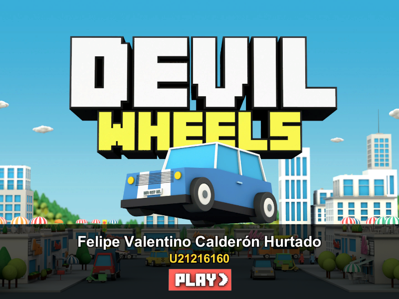
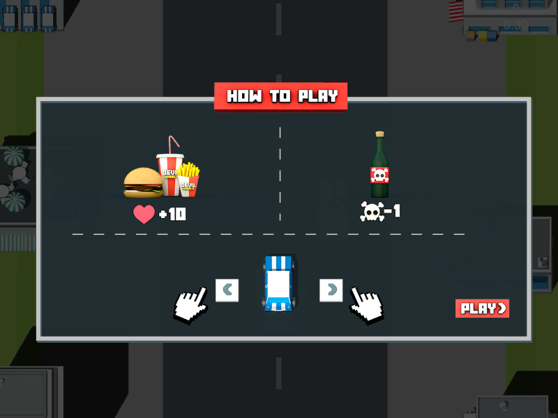
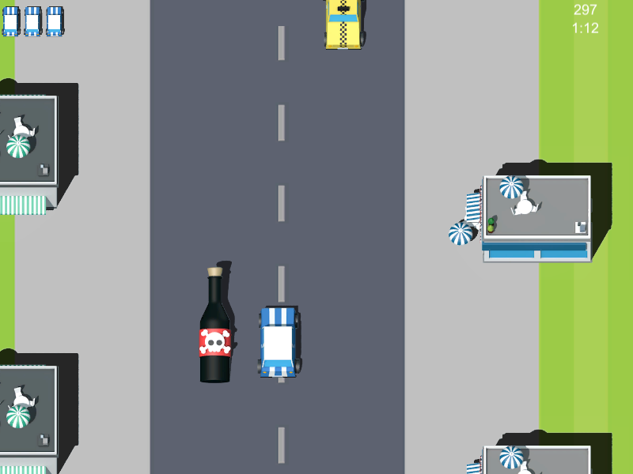
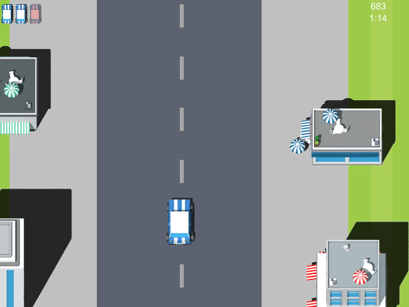
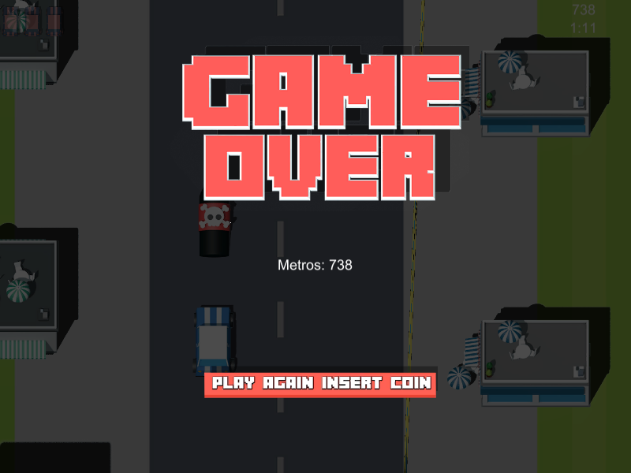

# Devil Wheels

Juego de carreteras hecho en Unity 6 (Semana S08).

**Felipe Valentino Calderón Hurtado — U21216160**

## ▶ Jugar
https://valentinoch-fel.github.io/devil-wheels/

## Controles
- **← →** o **A / D**: mover el carro
- **Enter / Espacio** o clic en **PLAY**: empezar

## Cómo se juega
- 🍔 Comida: **+10 segundos**
- 🍾 Botella o choque con otro carro: **-1 vida**
- Si te quedas sin vidas o sin tiempo: **Game Over** (con récord de metros)

## Grabaciones
- 🎬 [Video demostrativo (con sonido)](grabaciones/video_demostrativo.mp4)

| Portada | Instrucciones | Cuenta regresiva |
|---|---|---|
|  |  |  |

| Carrera | Choques | Game Over |
|---|---|---|
|  |  |  |
